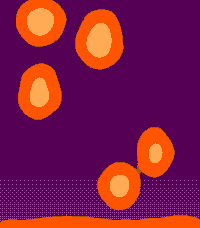

# Lava Lamp

A Pebble watchface for **Pebble Time 2 (emery)** and **Pebble Round 2 (gabbro)**.
Blobs of lava drift up and down a lamp, then pour themselves into the time,
hold for a few seconds, droop and melt apart again.

On the Rebble appstore as
[Lava Lamp](https://apps.repebble.com/lava-lamp_21794a91d4da4b669c2c3239) (v1.0.0).

 

<p>
  
  
  
</p>

## Showing the time

The time forms when you:

- **tap the screen** (both watches have touchscreens)
- **flick your wrist** (the accelerometer's tap event)
- **raise your wrist** (optional, see below)
- open the face, or change its settings
- let the minute tick over while the time is showing (it melts and re-forms)
- wait: it also forms on its own every 5 minutes by default

After the time melts, the lava keeps drifting for 30 seconds and then freezes
to save battery. The next glance wakes it.

### Raise to show

Pebble has no wrist-raise event, so `main.c` reads the accelerometer at 10Hz
(batches of 5, so the watch wakes twice a second) and looks for the screen
swinging from facing sideways or down (`z > -200`) to facing up
(`z < -550`) within 1.5s, with two settled face-up samples in a row and a 3s
cooldown. It's a heuristic. A slow, smooth raise may not trigger it, and
swinging your arms might sometimes trigger it by mistake. It can be turned off
in settings. Tapping and flicking always work.

## Settings (Clay)

| Setting | Default | Notes |
|---|---|---|
| Lava | Orange `FF5500` | Glowing core = each channel +1; edge = midpoint with the liquid |
| Liquid | Imperial purple `550055` | Bottom glow = each channel +1, dithered |
| Raise your wrist to show the time | On | Accelerometer subscription, see above |
| Also form the time on its own | Every 5 minutes | Every minute / 5 / 15 / never |
| Keep the lava moving | 30s after a glance | "Always" never freezes. Heavy on battery |

Uses `@rebble/clay`, not `pebble-clay`, which refuses to build for gabbro.

## How it works

`src/c/lava.c`: 150 metaballs. 120 are packed (sunflower spiral) into 5
blobs whose centres follow slow sums of sines, stretching into a teardrop when
they travel fast. 30 form a pool along the bottom of the glass. Each ball adds
`(1 - d²/R²)²` to a field. Pixels above thresholds become lava (`T_MAIN`), the
blob's glowing core (`T_CORE`, only reached inside packed blobs), or a one-pixel
blended edge (`T_RIM`).

Rendering is one row at a time straight into the framebuffer, with balls
sorted by top edge so each row only visits the balls that reach it. Positions
are Q4 fixed point so slow motion doesn't step. Each frame takes about 2–3ms
in the emulator, and the app uses about 17KB of the 128KB RAM.

`src/c/digits.c`: numerals are polylines in a 0..100 box, sampled at even
spacing into one target point per ball. Forming the time matches each target
to its nearest free blob ball. Unused blob balls drain into the pool. Each
ball blends from where its blob would put it to its target, so blobs stretch
into streams on the way. Melting adds a per-ball gravity sag before letting go.
The time is stacked (hours over minutes). In 12-hour mode a single-digit hour
is centred.

## Build and test

```bash
pebble build                          # release bundle: build/lava-lamp-digits.pbw
pebble install --emulator emery       # or gabbro
python3 tools/shot.py emery out.png   # screenshot via the QEMU monitor
python3 tools/gif.py emery out.gif 70 0.18
pebble emu-tap --emulator emery       # flick
pebble emu-accel --emulator emery custom tools/accel_raise.txt   # wrist raise
```

Verification-only build flags (never ship a bundle built with them):

- `LAVA_DEBUG=1 pebble build` draws fps, render ms, phase, target count and
  input/raise counters on screen.
- `LAVA_HOLD=1 pebble build` keeps the time formed forever.
- `LAVA_SHOW_TIME=1008 pebble build` always forms 10:08 (store screenshots).

Emulator screendumps write colour channels on a reduced scale (emery
0/33/66/100, gabbro 0/60/120/180) under a `255` header, so raw captures look
dim and muddy. `tools/shot.py`, `tools/gif.py` and `tools/record.py` rescale
them to the real colours. Append `@<sdk>` to the platform (`gabbro@4.33.1`) to
target one SDK's emulator when another session is running a second instance.

## Store assets

`store/` holds the appstore set, built by `tools/store_assets.py`:

| File | Size | Used for |
|---|---|---|
| `emery_1_preview.gif` … `emery_5_drift.png` | 200x228 | Time 2 screenshots |
| `gabbro_1_preview.gif` … `gabbro_5_drift.png` | 260x260 | Round 2 screenshots |
| `icon_80x80.png` | 80x80 | `pebble publish` iconSmall |
| `icon_144x144.png` | 144x144 | `pebble publish` iconLarge |
| `banner_720x320.png` | 720x320 | Store header image |

Screenshot names start with the platform because `pebble publish` works out
the platform from the text before the first underscore. The screenshots show
10:08 and three colour schemes. To regenerate, record each platform and
palette from a `LAVA_SHOW_TIME=1008` build (temporarily changing the default
colours in `settings.c` for the red/yellow and blue/navy takes), then:

```bash
python3 tools/record.py emery /tmp/lava_rec/emery_orange 12 --tap-at 1.0
python3 tools/record.py emery /tmp/lava_rec/emery_red 6 --tap-at 0.5
python3 tools/record.py emery /tmp/lava_rec/emery_blue 13 --tap-at 0.5
# ...same three for gabbro, then:
python3 tools/store_assets.py /tmp/lava_rec
```

Frame picks live in `PICKS` at the top of the script. Rebuild without the flag
before releasing, because `build/` keeps whichever variant was built last.

## Releasing

v1.0.0 is live on the store as "Lava Lamp". The repo, the folder and the
`displayName` in `package.json` still say "Lava Lamp Digits". To ship an
update, bump `version` in `package.json` past 1.0.0, then publish from a
clean release build:

```bash
pebble publish --non-interactive --no-gif-all-platforms \
  --release-notes "What changed" \
  --screenshots store/emery_*.{gif,png} store/gabbro_*.{gif,png}
```

Lava Lamp already exists on the store, so `pebble publish` takes its
existing-app path. The release goes live immediately, screenshots are added
rather than replaced (remove old ones on the developer dashboard), and
`--description` and `--icon-*` are ignored, so change those on the dashboard.
